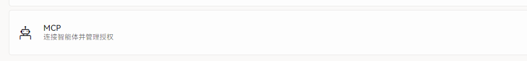

# 使用智能体协助制作

应用负责保存和审阅，材料读取与整理由电脑上的智能体完成。授权和最终交付始终由你决定。

## 选择「智能体制作」

**👉️ 在「新建项目」对话框里选择「智能体制作」**，按提示选择音频、填写课程标题，并按需加入试卷或听力原文。

<figure class="shot shot--dialog">
  
  智能体制作
  <figcaption>材料推荐 DOCX 或文字版 PDF，数量不限。</figcaption>
</figure>

## 打开 MCP 并复制配置

1. **👉️ 到「设置 → 制作与智能体」，打开 MCP。**
2. **👉️ 点「复制 MCP 配置」，粘贴到支持 HTTP MCP 的客户端（例如 WorkBuddy）。**
3. **👉️ 点「复制操作提示」，发给智能体。**

<figure class="shot">
  
  打开 MCP
  <figcaption>开关打开后，行内才会出现复制配置与授权相关操作。</figcaption>
</figure>

## 确认接管

智能体首次申请接管时，应用会显示它的名称和 60 秒倒计时。**👉️ 在应用内点「允许」。**

::: warning 看清楚再允许
接管期间应用会锁定编辑，并显示当前步骤和进度。不认识的智能体或客户端名称不要允许，可以随时在 MCP 设置里撤销授权。
:::

## 审阅并保存

**👉️ 智能体交还应用后，逐题检查字幕和题目，再点「保存」。**

<figure class="shot">
  
  <figcaption>智能体的结果只是初稿，字幕文字和题目答案仍要人工确认。</figcaption>
</figure>

**🎉 完成标志：** 保存后按「[保存并交付](./authoring#保存并交付)」导出 `.ilp`。
