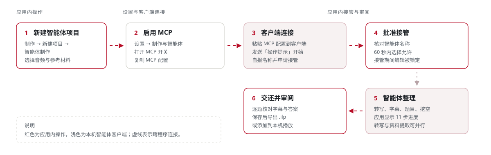
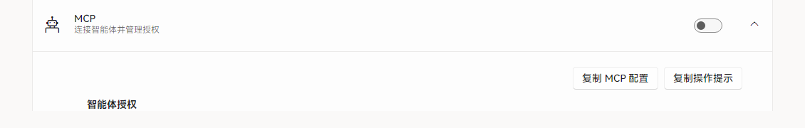
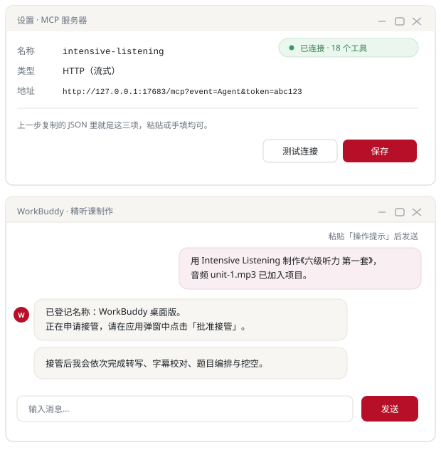
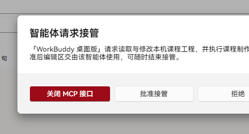
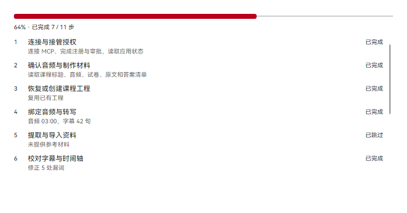

# 智能体制课

智能体指的是电脑上的 AI 助手程序（例如 WorkBuddy）。应用通过 **MCP** 与它连接：可以把 MCP 理解为应用给这个助手开的一条专用通道，配置一次即可反复使用。

制作时，应用把课程标题、音频和参考材料交给助手，助手整理出字幕、题目与挖空初稿；你在应用内批准它接管，结束后再逐项审阅、保存并导出。

<figure class="shot shot--diagram">
  
  <figcaption>智能体制课的完整链路。红色为应用内操作，浅色为本机智能体客户端。</figcaption>
</figure>

## 前置条件

- 已安装桌面应用，并完成[首次运行](./first-run)。
- 本机有支持 HTTP MCP 的智能体客户端。
- 已准备音频；可选准备试卷、答案或听力原文。

## 1. 新建智能体项目

1. 在左侧导航进入「制作」。
2. 点击右上角「新建项目」。
3. 在对话框中选择「智能体制作」。
4. 选择必需的音频文件。
5. 填写课程标题，并按需加入多份试卷或听力原文。
6. 确认材料列表后进入下一步。

<figure class="shot">
  

    
  

  <figcaption>材料推荐 DOCX 或文字版 PDF；音频为必选项。</figcaption>
</figure>

## 2. 启用 MCP 并复制配置

1. 进入「设置 → 制作与智能体」。
2. 展开 MCP 设置，打开 MCP 开关。
3. 点击「复制 MCP 配置」。
4. 点击「复制操作提示」，得到本次制作的任务说明。

<figure class="shot">
  

    
  

  <figcaption>开关启用后才会出现复制配置、复制操作提示与授权列表。</figcaption>
</figure>

## 3. 在智能体客户端里连上应用

这一步离开应用，在另一个程序里完成。要做的事只有两件：把地址交给客户端，再把任务交给它。

1. **找到客户端里的 MCP 设置。**
   一般在「设置 → MCP」或「工具 → MCP 服务器」，各客户端位置不同，认准 MCP 这几个字母即可。

2. **新建一个 HTTP MCP 服务器，粘贴上一步复制的配置。**
   多数客户端支持直接粘贴 JSON。只能逐项填写的，就照这三行填：
   - 名称：`intensive-listening`
   - 类型：`HTTP`
   - 地址：以 `http://127.0.0.1:17683/mcp` 开头的那一整串，`token=` 后面是访问令牌

3. **点一下「测试连接」；客户端没有这个按钮就直接保存。**
   客户端显示已连接、或能列出工具，说明通了。想再确认，用浏览器打开 `http://127.0.0.1:17683/test`，页面返回 `{"status":"ok"}` 即为正常。

4. **回到对话窗口，粘贴「操作提示」并发送。**
   这段文字会告诉智能体：做哪门课、音频和材料在哪、按什么顺序做。

<figure class="shot shot--diagram">
  
  <figcaption>示意图：按常见客户端布局绘制，不同软件的菜单名称可能不同。上半部分是连接设置，下半部分是发送「操作提示」后的对话。</figcaption>
</figure>

发送后的第一次请求，应用会记下客户端的自报名称（例如「WorkBuddy 桌面版」），同时弹出接管确认，也就是下一步。

::: tip 连不上时先查这三处
- 应用是否仍在运行，设置里的 MCP 开关是否打开。
- 配置是否整段粘全：地址末尾的 `token=` 少一位就会被拒绝。
- `17683` 端口是否被其他程序占用；被占用时 MCP 服务起不来，关掉占用的程序再重试。
:::

## 4. 批准接管

1. 智能体发起接管时，应用显示智能体名称与 60 秒授权窗口。
2. 核对名称是否与当前客户端一致。
3. 在 60 秒内选择允许，接管随即开始。

<figure class="shot">
  
  <figcaption>批准接管弹窗。「WorkBuddy 桌面版」是示例智能体名称，实际显示客户端自报的名称。</figcaption>
</figure>

::: warning 授权范围
接管期间应用会锁定编辑，并显示当前制作步骤与进度。名称或来源不明确时请拒绝；授权可在 MCP 设置中随时撤销，或删除注册记录。
:::

## 5. 查看制作进度

1. 制作过程共 11 步，覆盖音频与材料、转写、字幕校对、题目编排、重复朗读、挖空、校验与交还。
2. 应用显示每一步的状态、详情与整体百分比。
3. 转写与资料提取可以并行执行，无需等待其中一项完成。

<figure class="shot">
  
  <figcaption>进度面板：上方是整体百分比，下方是步骤列表，列表可滚动查看后续步骤。</figcaption>
</figure>

## 6. 交还后审阅与交付

1. 智能体调用交还后，应用自动刷新课程工程。
2. 打开工程，逐题核对字幕、题干、选项、答案与挖空。
3. 需要修改时直接编辑，完成后点击「保存」。
4. 选择「导出为精听包」或「添加到播放」。

智能体结果属于初稿，字幕文字与答案必须人工确认。保存与导出细节见[人工制课](./authoring#_6-保存并导出)。
