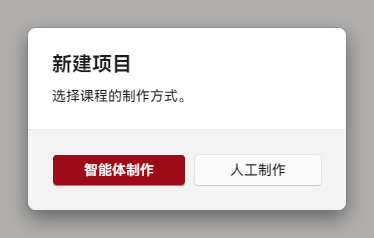
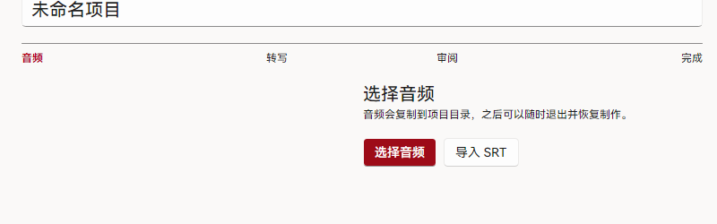
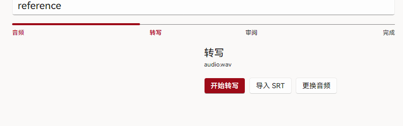
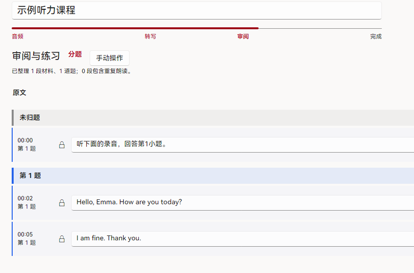
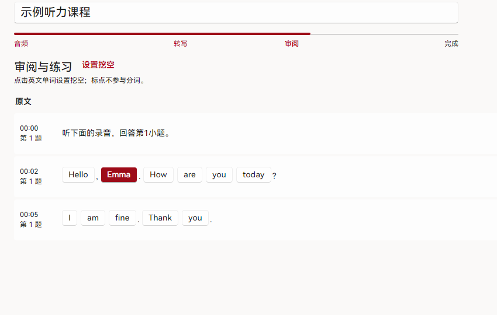

# 人工制课

人工制作适合需要逐句精修、或没有可用智能体客户端的场景。若希望由智能体整理初稿，优先参考[智能体制课](./agents)。

制作流程固定为「音频 → 转写 → 审阅 → 完成」。开始前请准备音频文件。

## 1. 新建课程工程

1. 在左侧导航进入「制作」。
2. 点击右上角「新建项目」。
3. 在对话框中选择「人工制作」。

<figure class="shot">
  

    
    
  

  <ol class="shot-key"><li>「人工制作」</li></ol>
  <figcaption>「智能体制作」用于交由本机智能体整理初稿。</figcaption>
</figure>

完成后进入空工程，并停留在「音频」步骤。

## 2. 绑定音频

1. 在「音频」步骤点击「选择音频」。
2. 选择 MP3、M4A 或 WAV 文件。
3. 已有匹配 SRT 时，可直接点击「导入 SRT」。

<figure class="shot">
  

    
    
  

  <ol class="shot-key"><li>「选择音频」</li></ol>
  <figcaption>音频会复制到工程目录，移动原文件不影响工程。</figcaption>
</figure>

## 3. 生成或导入字幕

1. 点击「开始转写」，任务进入转写队列。
2. 转写完成后，在工程内点击「载入字幕」。
3. 如已有 SRT，使用「导入 SRT」直接进入审阅。

<figure class="shot">
  

    
    
  

  <ol class="shot-key"><li>「开始转写」</li></ol>
  <figcaption>「更换音频」用于替换已绑定的录音；替换后需重新生成字幕。</figcaption>
</figure>

## 4. 校对字幕与题目

1. 播放音频，逐句修正文字与时间点。
2. 必要时合并或拆分句子。
3. 使用「选择整段」把句子归入对应材料。
4. 填写题号、题干、选项与答案，并绑定音频区间。
5. 使用「题目总览」检查所有小题，完成后点击「保存」。

<figure class="shot">
  

    
  

  <ol class="shot-key"><li>句左标注显示其所属题号</li></ol>
  <figcaption>保存前确认题目数量、答案与时间区间一致。</figcaption>
</figure>

## 5. 设置挖空

1. 点击「下一步：设置挖空」。
2. 点击需要学生辨听的英文单词，将其设为挖空。
3. 同一材料的重复朗读区间会同步对应挖空；再次点击可取消。

<figure class="shot">
  

    
  

  <ol class="shot-key"><li>已选词以框选状态显示</li></ol>
  <figcaption>标点不参与分词；挖空数量应与题目重点匹配。</figcaption>
</figure>

## 6. 保存并导出

1. 点击右下角「保存」。
2. 保存成功后，底部出现「导出为精听包」与「添加到播放」。
3. 点击「导出为精听包」，选择保存位置生成 `.ilp`。

::: warning 交付按钮不可见
若继续修改了字幕或题目，需要再次保存；工程状态显示「已完成」且无未保存修改时，交付按钮才会出现。
:::

导出完成后，可将 `.ilp` 分发给学生。[学生练习说明](./listening)
