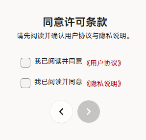
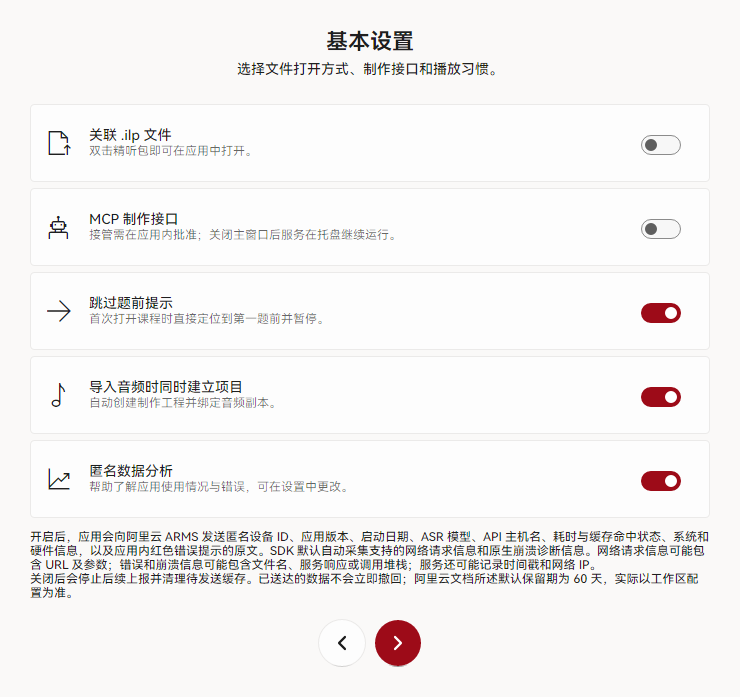
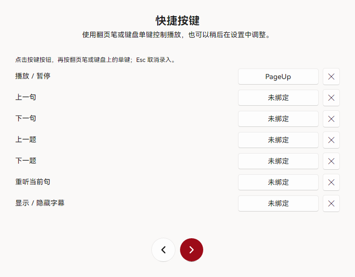
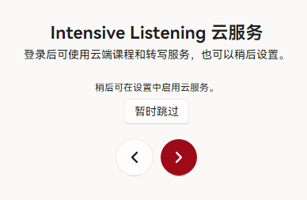
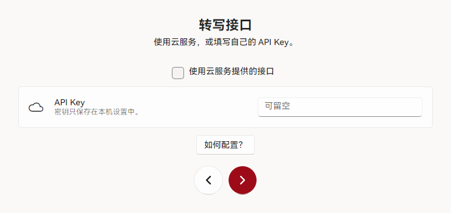

# 首次运行

首次启动会依次显示 8 个设置页。除许可条款外，其余页面均可保持默认值，完成后再按需调整。

## 1. 欢迎与许可（第 1–2 页）

1. 阅读用户协议与隐私说明。
2. 分别勾选两项确认框。
3. 点击右下角箭头进入下一步。

<figure class="shot">
  

    
  

  <figcaption>两项均勾选后，下一步按钮才可用。</figcaption>
</figure>

## 2. 基本设置（第 3 页）

1. 建议启用「关联 .ilp 文件」，便于后续双击课程包直接打开。
2. 按需启用 MCP 制作接口与「导入音频时同时建立项目」。
3. 按需关闭匿名数据分析。

<figure class="shot">
  

    
  

  <figcaption>未确定用途的选项保持默认；全部设置均可在「设置」中修改。</figcaption>
</figure>

## 3. 快捷按键（第 4 页）

1. 为播放、上一句、下一句等操作录入单键。
2. 翻页笔可使用 PageUp、PageDown。
3. 如暂不需要，直接进入下一步。

<figure class="shot">
  

    
  

  <figcaption>按键仅在应用前台、播放页处于激活状态时生效。</figcaption>
</figure>

## 4. 外观与云服务（第 5–6 页）

1. 选择浅色或深色主题。
2. 调整播放页字幕字号。
3. 云服务页可直接选择「暂时跳过」，稍后登录。

<figure class="shot">
  

    
  

  <figcaption>云服务用于云端课程与云端转写，不影响本地课程播放。</figcaption>
</figure>

## 5. 转写接口与完成（第 7–8 页）

1. 填写阿里云百炼 API Key，或勾选「使用云服务提供的接口」。
2. 可留空，稍后在设置中配置。
3. 最后一页点击「完成设置」。

<figure class="shot">
  

    
  

  <figcaption>留空不影响课程播放；开始转写前再配置亦可不迟。</figcaption>
</figure>

完成设置后进入播放页。自动字幕配置见[配置转写服务](./transcription)。
