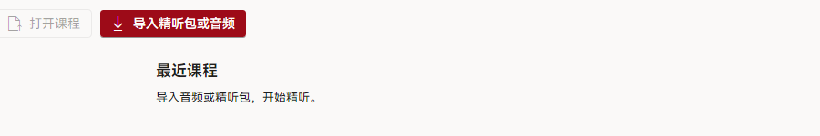
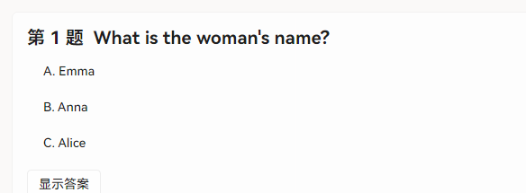
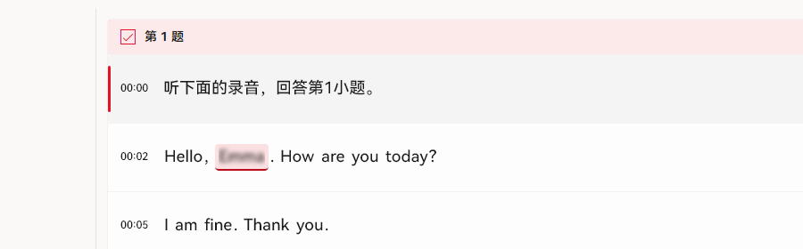
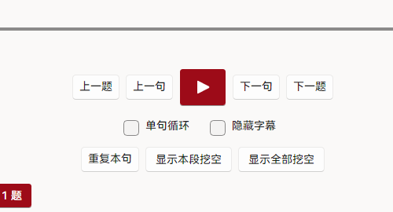

# 导入并播放课程

播放页用于逐句训练。左侧为题目区，右侧为字幕时间轴，底部为播放控制。

## 1. 导入精听包

1. 在播放页点击「导入精听包或音频」。
2. 选择 `.ilp` 文件。
3. 导入完成后，课程出现在「最近课程」列表。

<figure class="shot">
  

    
  

  <figcaption>已导入的课程会保留在「最近课程」，后续可直接打开。</figcaption>
</figure>

## 2. 查看题目与定位句子

1. 在左侧题目区确认题干与选项。
2. 使用「上一题」「下一题」切换题目。
3. 使用「上一句」「下一句」逐句移动，或直接点击目标句。

<figure class="shot">
  

    
  

  <figcaption>「显示答案」用于核对答案；练习时建议先保持隐藏。</figcaption>
</figure>

播放时右侧当前句会高亮并随播放推进，点击任意句可跳转定位。

<figure class="shot">
  

    
  

  <figcaption>时间点位于每句左侧，可用于确认句间间隔。</figcaption>
</figure>

## 3. 循环与盲听

1. 勾选「单句循环」，反复播放当前句。
2. 勾选「隐藏字幕」进行盲听。
3. 使用「重复本句」重听；使用「显示本段挖空」或「显示全部挖空」核对拼写。

<figure class="shot">
  

    
  

  <figcaption>挖空词在揭晓前显示为模糊占位，点击词槽可查看拼写。</figcaption>
</figure>

## 4. 恢复练习进度

课程进度按课程保存。再次打开同一课程时，应用会回到上次位置。字幕字号与「跳过题前提示」可在[设置](./settings)中调整。
