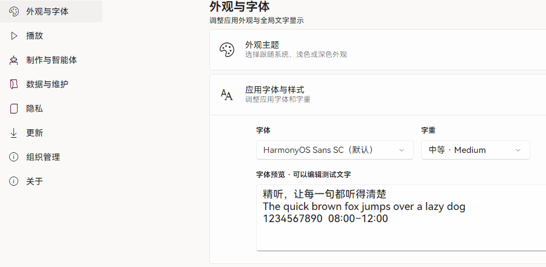

# 设置与快捷键

设置按分类排列：外观与字体、播放、制作与智能体、数据与维护、隐私、更新、组织管理、关于。

<figure class="shot">
  
  外观与字体
  <figcaption>左侧切换分类，右侧调整当前分类的选项。</figcaption>
</figure>

## 外观与字体

**👉️ 在「外观与字体」里选择系统字体和字重**，预览文字会即时更新；需要时点「恢复默认」。播放页字幕字号在「播放」分类里调整。

## 扩展按键

**👉️ 打开「播放 → 扩展按键」**，给播放／暂停、上一句／下一句、上一题／下一题、重听当前句和字幕显隐录入单键。

::: tip 翻页笔
PageUp、PageDown 适合翻页笔。按键只在应用前台的播放页生效，输入文字时不会触发。
:::
