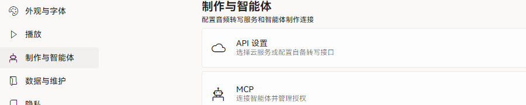
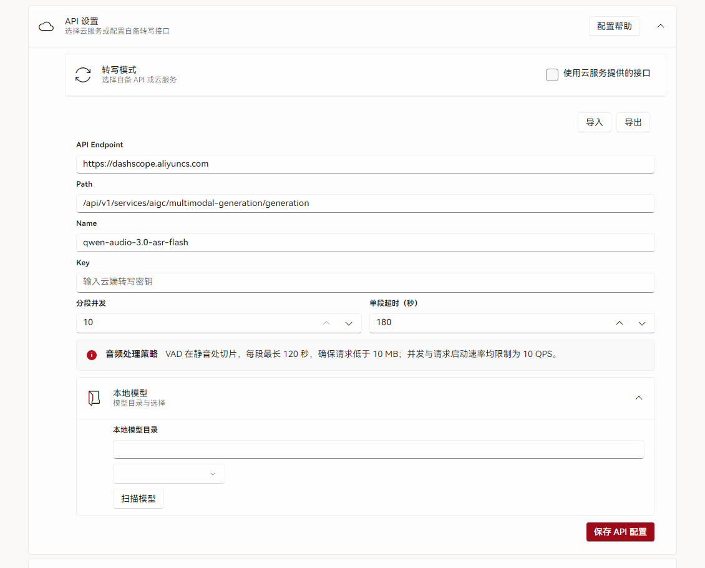
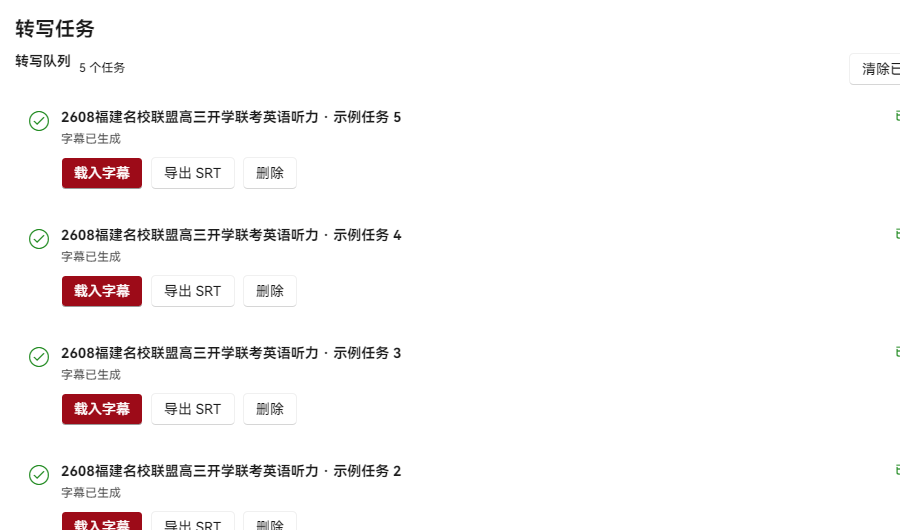

# 配置转写服务

转写服务用于把音频自动转换为带时间轴的字幕。已有匹配 SRT 时可跳过本章。

## 1. 打开 API 设置

1. 在左侧导航进入「设置」。
2. 选择「制作与智能体」分类。
3. 展开「API 设置」。

<figure class="shot">
  

    
  

  <figcaption>同一页面下方的 MCP 设置用于智能体制作，与转写互不影响。</figcaption>
</figure>

## 2. 创建并填写 API Key

1. 打开[阿里云百炼控制台](https://bailian.console.aliyun.com/)，开通服务。
2. 在「API Key」页面创建密钥并复制。
3. 回到应用，将密钥粘贴到「API 设置」的 Key 字段。
4. 北京地域可保留以下默认参数，然后点击「保存 API 配置」。

<figure class="shot">
  

    
  

  <figcaption>参数需与所选地域、模型一致；修改后必须重新保存。</figcaption>
</figure>

| 参数 | 默认值 |
| --- | --- |
| API Endpoint | `https://dashscope.aliyuncs.com` |
| Path | `/api/v1/services/aigc/multimodal-generation/generation` |
| Name | `qwen-audio-3.0-asr-flash` |
| 分段并发 | 10（范围 1–10） |
| 单段超时 | 180 秒 |

使用其他地域时，按[阿里云地域说明](https://help.aliyun.com/zh/model-studio/regions)核对接入地址与模型。

## 3. 提交转写任务

1. 返回「制作」，打开课程工程。
2. 在「转写」步骤点击「开始转写」。
3. 打开左下角「转写任务」查看进度。
4. 任务完成后点击「载入字幕」。

<figure class="shot">
  

    
  

  <figcaption>任务完成后可载入字幕，或先导出 SRT 备份。</figcaption>
</figure>

::: warning 转写失败时
先确认 API Key、Endpoint、模型三者属于同一地域，再重试。已有 SRT 时可直接导入，无需转写。
:::
